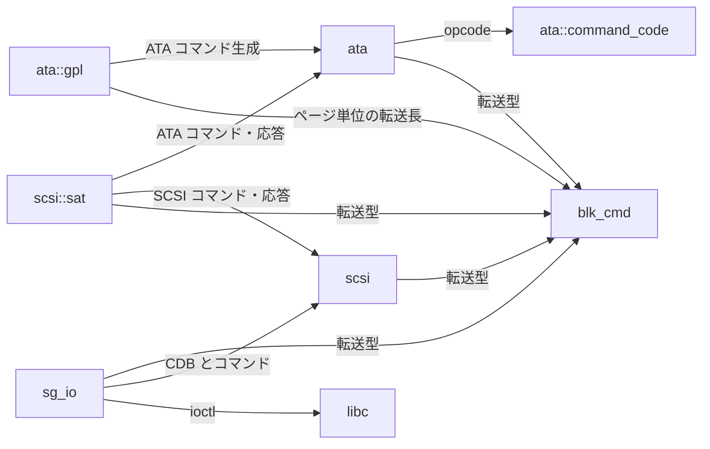
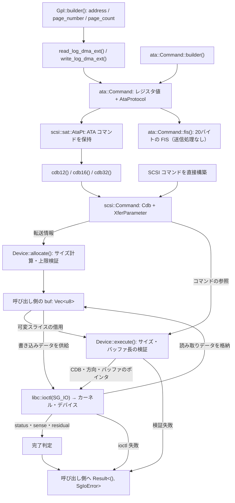
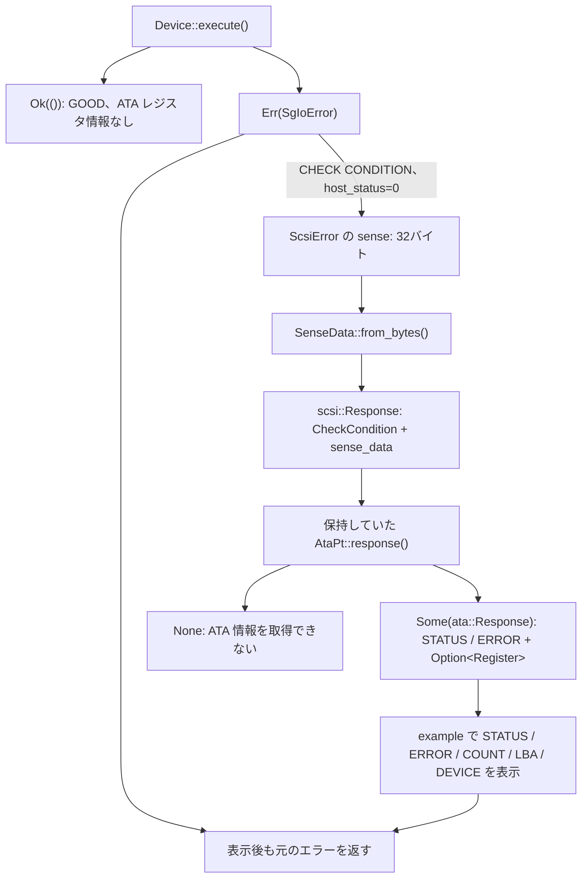

# 現在のアーキテクチャと依存関係

現在の作業ツリーの実装を整理したもの。単一 crate `lib_bbev`（Rust 2024）で、
`lib.rs` は `ata`・`blk_cmd`・`scsi`・`sg_io` を公開している。
`ata` 配下に `command_code`・`gpl`、`scsi` 配下に `sat` がある。

## モジュールの責務

| モジュール | 主な型 | 現在の責務 |
| --- | --- | --- |
| [`ata::command_code`](src/ata/command_code.rs) | `ata::CommandCode` | ATA コマンドの opcode 定義 |
| [`blk_cmd`](src/blk_cmd.rs) | `XferParameter`, `XferDirection`, `XferLength` | OS・バックエンドに依存しない共通の転送型 |
| [`ata`](src/ata.rs) | `Command`, `CommandBuilder`, `AtaProtocol`, `Response`, `Register` | ATA コマンド・応答の表現、20バイトの H2D FIS 生成 |
| [`ata::gpl`](src/ata/gpl.rs) | `Gpl`, `GplBuilder` | GPL のログアドレス・ページ指定から DMA / FPDMA の読み書きコマンドを生成 |
| [`scsi`](src/scsi.rs) | `Cdb`, `Command`, `Status`, `Response`, `SenseData` | SCSI コマンド・応答の表現、sense バイト列の解析 |
| [`scsi::sat`](src/scsi/sat.rs) | `AtaPt` | ATA PASS-THROUGH (12)/(16)/(32) の生成、SCSI 応答から ATA 応答への変換 |
| [`sg_io`](src/sg_io.rs) | `Device`, `SgIoError` | サイズ計算・検証、バッファ確保、Linux SG_IO ioctl、完了判定・エラー表示 |

## コード上の依存関係

矢印は「参照する側 → 参照される側」。実行順序とは異なる。

`command_code` と `blk_cmd` は他の内部モジュールに依存しない。
`ata` と `scsi` の基本型は `sg_io` に依存しない。
`scsi` の基本型は ATA を参照せず、子モジュールの `scsi::sat` が両者の変換を担当する。

外部依存は `libc`。`sg_io` で使用している。
`ata::CommandBuilder` は自前実装で、`nondata()`・`pio_data_in(len)` などの
protocol 選択メソッドが完成した `ata::Command` を返す。公開の `build()` はなく、LBA48 の検証は行わない。
`GplBuilder` も `read_log_dma_ext()` などのコマンド選択メソッドで `ata::Command` を返す。

## コマンドとデータの流れ

[`examples/gpl.rs`](examples/gpl.rs) の GPL ログ読み書きを中心に示す。
`allocate()` で確保したバッファは呼び出し側が保持し、`execute()` に借用させる。

読み取りと書き込みのデータ矢印は、転送方向に応じた別々の経路を表す。
データは戻り値には含まれず、呼び出し側のバッファを通じて受け渡す。
`allocate()` の検証失敗も `SgIoError` として呼び出し側へ返る。

`blk_cmd` の `XferParameter` はデータ転送の有無、`XferDirection` は方向と長さ、
`XferLength` は `Sectors`・`Pages`・`Bytes` を表す。
`Device` がセクタ数を指定されたセクタサイズで、ページ数を512バイト単位で換算し、
転送上限とバッファ長を検証する。

デバイスファイルは呼び出し側が開き、`Device` は渡された raw fd を保持する。
fd の所有・クローズは管理しない。`execute()` は同期実行で、
status・host_status・driver_status のいずれかが非ゼロ、または residual が非ゼロならエラー。
戻り値は `Result<(), SgIoError>` で、`scsi::Response` を直接返す API ではない。

## 応答の流れ

`scsi::Response` は `Status` と `Option<SenseData>` を持つ。
`SenseData` は Current / Deferred と Fixed / Descriptor の組み合わせを4つの variant で表す。
`SenseData::from_bytes()` は形式と追加長を読み、`FixedSense` または `DescriptorSense` に変換する。
descriptor 本体のバイト列は保持し、ATA 固有の解釈は `scsi::sat` が行う。

現在は `examples/gpl.rs` が SG_IO のエラーから SCSI 応答を組み立てている。

`AtaPt::response()` は現在のコマンドの CHECK CONDITION を対象にする。
descriptor 形式では ATA Status Return descriptor (`0x09`) を探して28bit / 48bit の値を復元する。
fixed 形式では INFORMATION と COMMAND-SPECIFIC INFORMATION を使う。
fixed 形式で上位 COUNT / LBA が非ゼロの場合は完全に復元できないため、
STATUS / ERROR を保持し、`register: None` とする。
Deferred や ATA 情報のない応答、不完全なデータ、完了値が抑制される PIO Data-In / NCQ の通知は `None` になる。

## 分離を考える上での境界

- 転送型は `blk_cmd` に集約し、ATA・SCSI・SAT・SG_IO が同じ型を使う。`AtaProtocol` から SCSI コマンドに載せる `XferParameter` への変換は `scsi::sat::AtaPt` が担当する。
- SCSI のコマンド・sense 定義は `scsi`、ATA と SCSI の相互変換は `scsi::sat` が担当する。
- `Device` がデバイス設定、転送サイズ計算、確保、送信、完了判定をまとめて担当する。
- `ata::Command` のレジスタ値と `protocol` フィールドは `pub` で、外部ドライバから参照できる。
- `Cdb::as_bytes()` は公開されており、外部ドライバから CDB のバイト列を参照できる。
- `sg_io` はまだ生の sense をエラーに含める。`scsi::Response` の生成と SAT への受け渡しは example 側が担当している。
- I/O を差し替える共通 trait はなく、実行 API とエラー型は `sg_io` 固有になっている。
