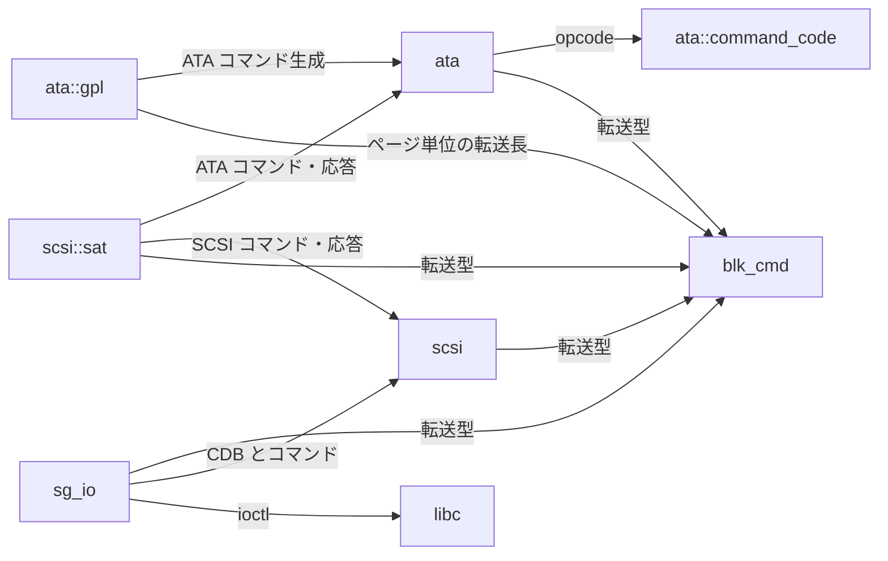
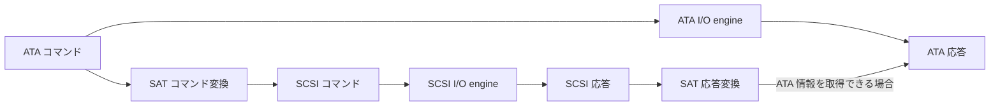
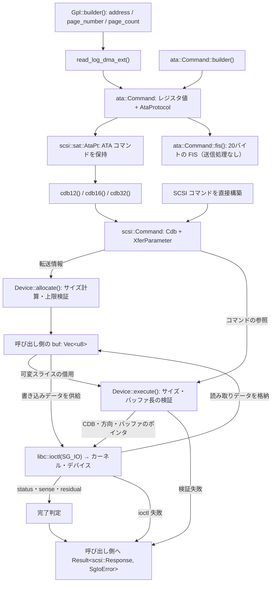
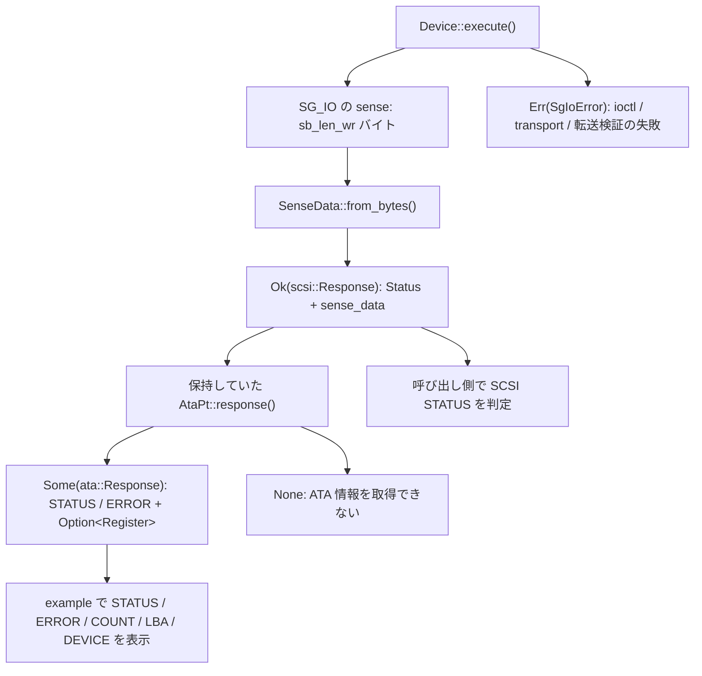

# 現在のアーキテクチャと依存関係

現在の作業ツリーの実装を整理したもの。単一 crate `lib_bbev`（Rust 2024）で、
`lib.rs` は `ata`・`blk_cmd`・`scsi`・`sg_io` を公開している。
`ata` 配下に `command_code`・`gpl`、`scsi` 配下に `sat` がある。

## モジュールの責務

| モジュール | 主な型 | 現在の責務 |
| --- | --- | --- |
| [`ata::command_code`](src/ata/command_code.rs) | `ata::CommandCode` | ATA コマンドの opcode 定義 |
| [`blk_cmd`](src/blk_cmd.rs) | `XferParameter`, `XferDirection`, `XferLength` | OS・バックエンドに依存しない共通の転送型 |
| [`ata`](src/ata.rs) | `Command`, `CommandBuilder`, `AtaProtocol`, `Response`, `Register` | ATA フィールド・protocol・応答の表現、20バイトの H2D FIS 生成 |
| [`ata::gpl`](src/ata/gpl.rs) | `Gpl`, `GplBuilder` | GPL のログアドレス・ページ指定から DMA / FPDMA の読み書きコマンドを生成 |
| [`scsi`](src/scsi.rs) | `Cdb`, `Command`, `Status`, `Response`, `SenseData` | CDB・転送情報・応答の表現、sense バイト列の解析 |
| [`scsi::sat`](src/scsi/sat.rs) | `AtaPt` | ATA PASS-THROUGH (12)/(16)/(32) の生成、SCSI 応答から ATA 応答への変換 |
| [`sg_io`](src/sg_io.rs) | `Device`, `SgIoError` | SCSI コマンド情報を使った Linux SG_IO ioctl、サイズ計算・検証、バッファ確保 |

## コード上の依存関係

矢印は「参照する側 → 参照される側」。実行順序とは異なる。

`command_code` と `blk_cmd` は他の内部モジュールに依存しない。
`ata` と `scsi` の基本型は `sg_io` に依存しない。
`scsi` の基本型は ATA を参照せず、子モジュールの `scsi::sat` が両者の変換を担当する。

ライブラリの外部依存は `libc`。`sg_io` で使用している。
GPL example の引数処理には開発用依存の `clap` を使う。
`ata::CommandBuilder` は自前実装で、`nondata()`・`pio_data_in(len)` などの
protocol 選択メソッドが完成した `ata::Command` を返す。公開の `build()` はなく、LBA48 の検証は行わない。
`GplBuilder` も `read_log_dma_ext()` などのコマンド選択メソッドで `ata::Command` を返す。

## I/O の境界

ATA / SCSI はコマンド情報と形式変換を提供し、I/O engine が必要な情報を取り出して送信する。
ATA I/O engine は ATA コマンドを、SCSI I/O engine は SCSI コマンドを扱い、それぞれの応答を返す。
送信 API・バッファ管理・転送の検証・送信エラーの扱いは各 I/O engine が決める。

| I/O engine | 入力 | 送信に使う情報 | 応答 |
| --- | --- | --- | --- |
| ATA I/O engine | ATA コマンド | レジスタ値または FIS、protocol、転送方向・長さ | ATA 応答 |
| SCSI I/O engine | SCSI コマンド | CDB、転送方向・長さ | SCSI 応答 |

SAT は ATA と SCSI のコマンド・応答を変換する。呼び出し側は SAT を使い、
ATA コマンドを SCSI I/O engine に渡し、SCSI 応答から取得できる ATA 情報を取り出せる。
バッファは呼び出し側が所有し、I/O engine に渡す。

現在の `sg_io` は SCSI I/O engine の実装に当たる。
ATA / SCSI のコマンド・応答の型と SAT は、特定の I/O engine に依存しない。

## コマンドとデータの流れ

[`examples/gpl.rs`](examples/gpl.rs) の GPL ログ読み取りを中心に示す。
`gpl <device> -a <address> -n <number> -c <count>` で読み取るログとページを指定し、xxd風に表示する。
`allocate()` で確保したバッファは呼び出し側が保持し、`execute()` に借用させる。

読み取りと書き込みのデータ矢印は、転送方向に応じた別々の経路を表す。
データは戻り値には含まれず、呼び出し側のバッファを通じて受け渡す。
`allocate()` の検証失敗も `SgIoError` として呼び出し側へ返る。

`blk_cmd` の `XferParameter` はデータ転送の有無、`XferDirection` は方向と長さ、
`XferLength` は `Sectors`・`Pages`・`Bytes` を表す。
`Device` がセクタ数を指定されたセクタサイズで、ページ数を512バイト単位で換算し、
転送上限とバッファ長を検証する。

デバイスファイルは呼び出し側が開き、`Device` は渡された raw fd を保持する。
fd の所有・クローズは管理しない。`execute()` は同期実行で、
戻り値は `Result<scsi::Response, SgIoError>`。
CHECK CONDITION・BUSY なども `Ok(Response)` として返すので、呼び出し側が `response.status` を確認する。
生の status 値から `Status` への変換は SG_IO 側で行い、未定義の値も `Status::Other(u8)` で保持する。

host / driver の失敗は `TransportError` にする。ただし CHECK CONDITION の
`DRIVER_SENSE` (`0x08`) は sense の通知として扱う。
GOOD は全量転送を要求し、residual が非ゼロなら `UnexpectedResidual` にする。
他の status では部分転送を許すが、負の residual や要求長を超える残量はエラーにする。

## 応答の流れ

`scsi::Response` は `Status` と `Option<SenseData>` を持つ。
`SenseData` は Current / Deferred と Fixed / Descriptor の組み合わせを4つの variant で表す。
`SenseData::from_bytes()` は形式と追加長を読み、`FixedSense` または `DescriptorSense` に変換する。
descriptor 本体のバイト列は保持し、ATA 固有の解釈は `scsi::sat` が行う。

SG_IO は `sb_len_wr` で示された有効な sense の範囲だけを解析して `scsi::Response` を返す。
`examples/gpl.rs` はその応答を保持していた `AtaPt` に渡す。

`AtaPt::response()` は現在のコマンドの CHECK CONDITION を対象にする。
descriptor 形式では ATA Status Return descriptor (`0x09`) を探して28bit / 48bit の値を復元する。
fixed 形式では INFORMATION と COMMAND-SPECIFIC INFORMATION を使う。
fixed 形式で上位 COUNT / LBA が非ゼロの場合は完全に復元できないため、
STATUS / ERROR を保持し、`register: None` とする。
Deferred や ATA 情報のない応答、不完全なデータ、完了値が抑制される PIO Data-In / NCQ の通知は `None` になる。

## 分離を考える上での境界

- 転送型は `blk_cmd` に集約し、ATA・SCSI・SAT・SG_IO が同じ型を使う。`AtaProtocol` から SCSI コマンドに載せる `XferParameter` への変換は `scsi::sat::AtaPt` が担当する。
- SCSI のコマンド・sense 定義は `scsi`、ATA と SCSI の相互変換は `scsi::sat` が担当する。
- I/O engine がコマンド情報を参照して送信する。SG_IO の `Device` はデバイス設定、転送サイズ計算、確保、ioctl、完了判定を担当する。
- `ata::Command` のレジスタ値と `protocol` フィールドは `pub` で、外部ドライバから参照できる。
- `Cdb::as_bytes()` は公開されており、外部ドライバから CDB のバイト列を参照できる。
- `sg_io` が `scsi::Response` を生成し、SAT への受け渡しは example 側が担当する。送信失敗時の生の sense は `TransportError` に残す。
- ATA / SCSI I/O engine はそれぞれのコマンド・応答の型を使って実装でき、`sg_io` への依存は不要。
